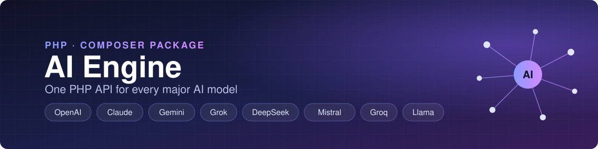

<p align="center">
  
</p>

<p align="center">
  <a href="https://packagist.org/packages/rajanvijayan/ai-engine"></a>
  <a href="https://packagist.org/packages/rajanvijayan/ai-engine"></a>
  <a href="https://github.com/rajanvijayan/ai-engine/actions/workflows/ci.yml"></a>
  <a href="LICENSE"></a>
</p>

# AI Engine - Multi-Provider PHP Library

A lightweight, dependency-free PHP library for integrating the major AI providers into your applications through a single API. Supports **OpenAI**, **Anthropic Claude**, **Google Gemini**, **xAI Grok**, **DeepSeek**, **Mistral**, **Groq** and **Meta Llama**, with conversation history and built-in RAG.

## 🚀 Features

- **8 Providers, One API**: OpenAI, Anthropic, Gemini, xAI, DeepSeek, Mistral, Groq and Meta Llama
- **Latest Models**: GPT-6.1, Claude Opus 5.5, Gemini 3.8, Grok 4.7, DeepSeek V4 and more
- **Conversation Mode**: Maintains chat history for context-aware responses
- **Knowledge Base (RAG)**: Ground answers in URLs or your own text, on every provider
- **Easy Provider Switching**: Switch between providers on the fly; knowledge carries over
- **System Instructions**: Set AI personality/behavior per conversation
- **Typed Responses & Exceptions**: `Response` objects and a clear exception hierarchy
- **Zero Dependencies**: Pure PHP; no SDKs or HTTP clients required
- **Extensible**: Add any OpenAI-compatible provider in about 10 lines

## 📋 Requirements

- PHP 8.0 or higher
- `json` extension
- `allow_url_fopen` enabled
- Composer

## 🛠️ Installation

```bash
composer require rajanvijayan/ai-engine
```

## 🔑 API Keys

| Provider | Name in AIEngine | Aliases | Get a key |
|----------|------------------|---------|-----------|
| OpenAI | `openai` | `gpt` | [platform.openai.com](https://platform.openai.com/api-keys) |
| Anthropic | `anthropic` | `claude` | [platform.claude.com](https://platform.claude.com/settings/keys) |
| Google Gemini | `gemini` | | [aistudio.google.com](https://aistudio.google.com/app/apikey) |
| xAI | `xai` | `grok` | [console.x.ai](https://console.x.ai) |
| DeepSeek | `deepseek` | | [platform.deepseek.com](https://platform.deepseek.com/api_keys) |
| Mistral | `mistral` | | [console.mistral.ai](https://console.mistral.ai/api-keys) |
| Groq | `groq` | | [console.groq.com](https://console.groq.com) (**free tier available!**) |
| Meta Llama | `meta` | `llama`, `meta-llama` | [llama.meta.com](https://llama.meta.com) |

> Never commit API keys. Load them from environment variables or a secrets manager.

## 🚀 Quick Start

### Basic Usage

```php
<?php
require_once 'vendor/autoload.php';

use AIEngine\AIEngine;

// Create with Gemini (default)
$ai = new AIEngine(getenv('GEMINI_API_KEY'));
$response = $ai->generateContent('Hello! How are you?');
echo $response;
```

### Choose a Provider

```php
// OpenAI
$ai = AIEngine::create('openai', getenv('OPENAI_API_KEY'));

// Anthropic Claude
$ai = AIEngine::create('anthropic', getenv('ANTHROPIC_API_KEY'));

// xAI Grok
$ai = AIEngine::create('xai', getenv('XAI_API_KEY'));

// DeepSeek
$ai = AIEngine::create('deepseek', getenv('DEEPSEEK_API_KEY'));

// Mistral
$ai = AIEngine::create('mistral', getenv('MISTRAL_API_KEY'));

// Groq
$ai = AIEngine::create('groq', getenv('GROQ_API_KEY'));

// Pick a specific model
$ai = new AIEngine(getenv('OPENAI_API_KEY'), [
    'provider' => 'openai',
    'model' => 'gpt-6-astra',
]);
```

### Conversation Mode

```php
$ai = AIEngine::create('claude', getenv('ANTHROPIC_API_KEY'));
$ai->setSystemInstruction('You are a helpful assistant.');

$ai->chat('My name is John');
echo $ai->chat("What's my name?");  // AI remembers: "John"

// Clear conversation
$ai->newConversation();
```

## 📚 API Reference

### Constructor

```php
new AIEngine($apiKey, $config = [])
```

**Config Options:**
```php
[
    'provider' => 'gemini',     // 'openai', 'anthropic', 'gemini', 'xai', 'deepseek', 'mistral', 'groq', 'meta'
    'model' => null,            // Model name (uses provider default if null)
    'timeout' => 60,            // Request timeout in seconds
    'enable_logging' => false   // Enable logging
]
```

### Methods

| Method | Description |
|--------|-------------|
| `generateContent($prompt)` | Single prompt, no history. Returns `Response` |
| `chat($message)` | Send message with conversation history. Returns `Response` |
| `newConversation()` | Clear conversation history |
| `getHistory()` | Get conversation history array |
| `setSystemInstruction($text)` | Set AI personality/behavior |
| `switchProvider($name, $apiKey, $model = null)` | Switch to a different provider |
| `getProviderName()` | Get current provider name |
| `getProvider()` | Get the underlying provider instance |
| `addKnowledgeFromUrl($url)` | Add a web page to the knowledge base |
| `addKnowledgeText($text, $source)` | Add raw text to the knowledge base |
| `getAvailableProviders()` | List supported provider names |

### Static Methods

| Method | Description |
|--------|-------------|
| `AIEngine::create($provider, $apiKey, $config = [])` | Factory method |
| `AIEngine::getModelsForProvider($provider)` | List available models |
| `AIEngine::getDefaultModels()` | Get default model per provider |

### Response Object

```php
$response = $ai->chat('Hello');

$response->getText();         // The generated text
$response->getProvider();     // e.g. "Anthropic"
$response->getModel();        // e.g. "claude-opus-5-5"
$response->getRawResponse();  // Decoded API response array
echo $response;               // Casts to the text
```

## 🤖 Available Models

Default models are marked in **bold**. You can pass any model ID your provider supports; the lists below are the ones the library knows about.

| Provider | Models |
|----------|--------|
| OpenAI | **`gpt-6.1-sol`**, `gpt-6-astra`, `gpt-6.1-terra`, `gpt-6-luna` |
| Anthropic | **`claude-opus-5-5`**, `claude-sonnet-5-5`, `claude-haiku-5-5`, `claude-fable-5-1` |
| Gemini | **`gemini-3.8-flash`**, `gemini-3.6-flash`, `gemini-3.5-flash-lite`, `gemini-3.1-flash-lite`, `gemini-3.1-pro-preview`, `gemini-3-flash-preview`, `gemini-2.5-pro`, `gemini-2.5-flash`, `gemini-2.5-flash-lite` |
| xAI | **`grok-4.7`**, `grok-4.6`, `grok-4.5`, `grok-4.3`, `grok-4.20-0309-reasoning`, `grok-4.20-0309-non-reasoning` |
| DeepSeek | **`deepseek-flash`**, `deepseek-v4-pro` |
| Mistral | **`mistral-large-latest`**, `mistral-medium-latest`, `mistral-small-latest`, `ministral-8b-latest`, `codestral-latest` |
| Groq | **`llama-3.3-70b-versatile`**, `llama-3.1-8b-instant`, `openai/gpt-oss-120b`, `openai/gpt-oss-20b`, `qwen/qwen3.8-27b`, `minimaxai/minimax-m2.7`, `meta-models/muse-spark-open` |
| Meta Llama | **`Llama-4-Maverick-17B-128E-Instruct-FP8`**, `Llama-4-Scout-17B-16E-Instruct`, `Llama-3.3-70B-Instruct`, `Llama-3.2-3B-Instruct`, `Llama-3.2-1B-Instruct` |

### Anthropic-specific options

```php
use AIEngine\Providers\Anthropic;

$ai = AIEngine::create('anthropic', getenv('ANTHROPIC_API_KEY'));

/** @var Anthropic $claude */
$claude = $ai->getProvider();
$claude->setMaxTokens(4096);       // Default: 16000
$claude->enableFallbacks(false);   // Server-side refusal fallbacks are on by default
```

When the model's safety classifiers decline a request, Anthropic can retry it on a fallback model. AIEngine turns this on by default for models that support it (`claude-opus-5-5`, `claude-sonnet-5-5`, `claude-fable-5-1`). If a request is still declined, an `ApiException` is thrown.

## 💬 Usage Examples

### Conversation with Memory

```php
$ai = AIEngine::create('openai', getenv('OPENAI_API_KEY'));
$ai->setSystemInstruction('You are a math tutor. Be concise.');

echo $ai->chat('What is 15 + 27?');      // "42"
echo $ai->chat('Multiply that by 2');     // "84" - remembers previous answer!
```

### Switch Providers Mid-Session

```php
$ai = new AIEngine(getenv('GEMINI_API_KEY'));
echo $ai->getProviderName();  // "Gemini"

$ai->switchProvider('claude', getenv('ANTHROPIC_API_KEY'));
echo $ai->getProviderName();  // "Anthropic"
```

### Knowledge Base (RAG)

```php
$ai = AIEngine::create('deepseek', getenv('DEEPSEEK_API_KEY'));

$ai->addKnowledgeFromUrl('https://example.com/docs');
$ai->addKnowledgeText('Our support hours are 9am-5pm EST.', 'support-policy');

echo $ai->chat('When is support available?');
```

### Error Handling

```php
use AIEngine\Exceptions\AIEngineException;
use AIEngine\Exceptions\ApiException;
use AIEngine\Exceptions\ConfigurationException;

try {
    $response = $ai->chat('Hello');
    echo $response;
} catch (ConfigurationException $e) {
    // Missing API key, empty or overly long prompt
    echo 'Configuration error: ' . $e->getMessage();
} catch (ApiException $e) {
    // Network failure or error returned by the provider
    echo "API error from {$e->getProvider()}: " . $e->getMessage();
} catch (AIEngineException $e) {
    echo 'Error: ' . $e->getMessage();
}
```

## 🧪 Testing

```bash
composer test      # PHPUnit
composer lint      # PHPStan + PHP-CS-Fixer
composer ci        # Everything
```

### Interactive Test

Create a `test.ai-key` file in the project root (it is git-ignored) with the keys you have:

```json
{
    "openai": "YOUR_OPENAI_API_KEY",
    "anthropic": "YOUR_ANTHROPIC_API_KEY",
    "gemini": "YOUR_GEMINI_API_KEY",
    "xai": "YOUR_XAI_API_KEY",
    "deepseek": "YOUR_DEEPSEEK_API_KEY",
    "mistral": "YOUR_MISTRAL_API_KEY",
    "groq": "YOUR_GROQ_API_KEY",
    "meta": "YOUR_META_LLAMA_API_KEY"
}
```

Then run:

```bash
php test.php
```

This launches an interactive chat where you can:
- Select a provider
- Chat with the AI
- Use `/new` to clear conversation
- Use `/quit` to exit

## 📁 Project Structure

```
ai-engine/
├── src/
│   ├── AIEngine.php                        # Main engine class
│   ├── Response.php                        # Response object
│   ├── Exceptions/                         # AIEngineException, ApiException, ConfigurationException
│   ├── Knowledge/                          # KnowledgeBase + UrlFetcher (RAG)
│   ├── Utils/                              # ConfigValidator
│   └── Providers/
│       ├── ProviderInterface.php           # Provider contract
│       ├── OpenAICompatibleProvider.php    # Shared base for OpenAI-style APIs
│       ├── OpenAI.php                      # OpenAI GPT
│       ├── Anthropic.php                   # Anthropic Claude
│       ├── Gemini.php                      # Google Gemini
│       ├── XAI.php                         # xAI Grok
│       ├── DeepSeek.php                    # DeepSeek
│       ├── Mistral.php                     # Mistral AI
│       ├── Groq.php                        # Groq
│       └── MetaLlama.php                   # Meta Llama API
├── tests/                                  # PHPUnit tests
├── test.php                                # Interactive test
└── composer.json
```

## 🔧 Adding New Providers

Most providers now expose an OpenAI-compatible Chat Completions API. For those, extend `OpenAICompatibleProvider`:

```php
namespace App\AI;

use AIEngine\Providers\OpenAICompatibleProvider;

class Together extends OpenAICompatibleProvider
{
    public const DEFAULT_MODEL = 'meta-llama/Llama-3.3-70B-Instruct-Turbo';

    protected string $api_url = 'https://api.together.xyz/v1/chat/completions';

    public function getName(): string
    {
        return 'Together';
    }

    public static function getAvailableModels(): array
    {
        return [self::DEFAULT_MODEL];
    }
}

$ai = new AIEngine($key);
$ai->setProvider(new Together($key));
```

For other APIs, implement `ProviderInterface` directly (see `Anthropic.php` or `Gemini.php` for examples).

## 📄 License

MIT License - see [LICENSE](LICENSE) file.

---

**Made with ❤️ for the PHP community**
